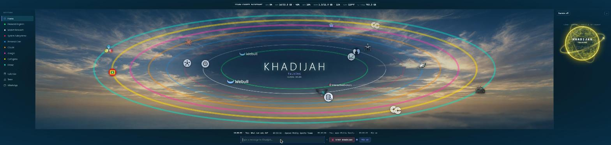
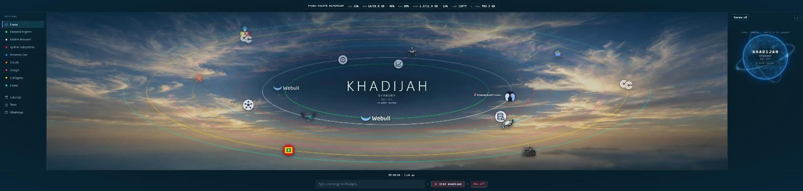
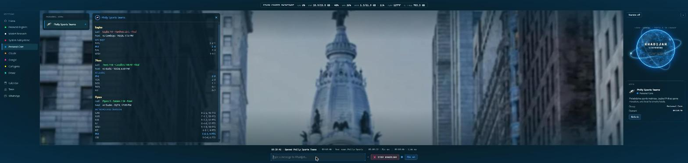
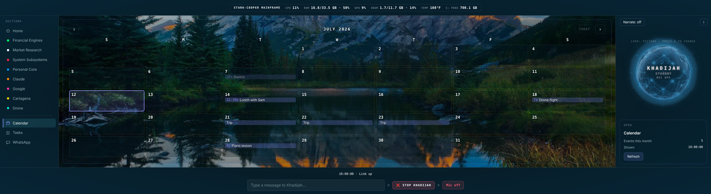
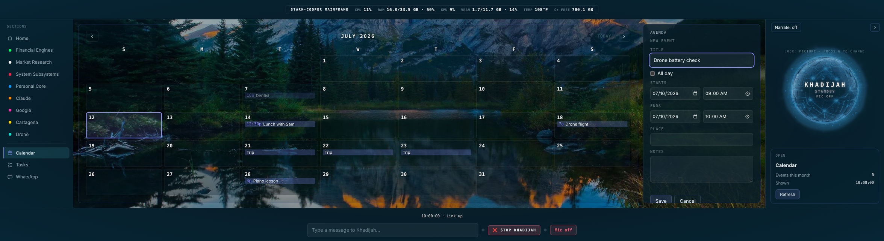
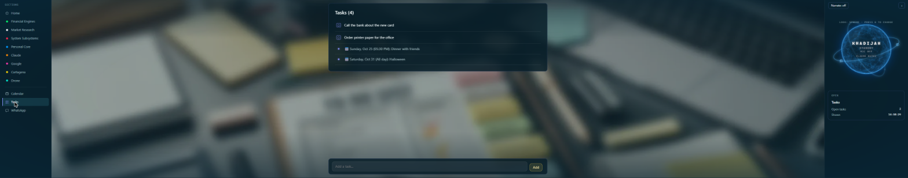
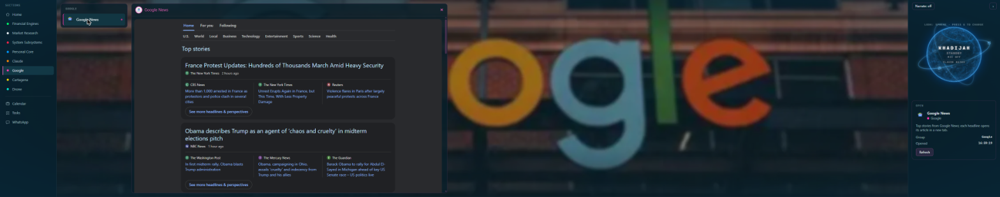
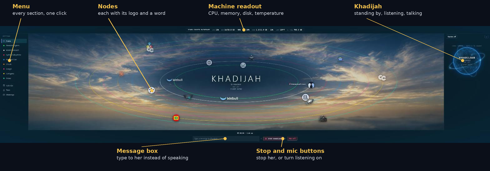
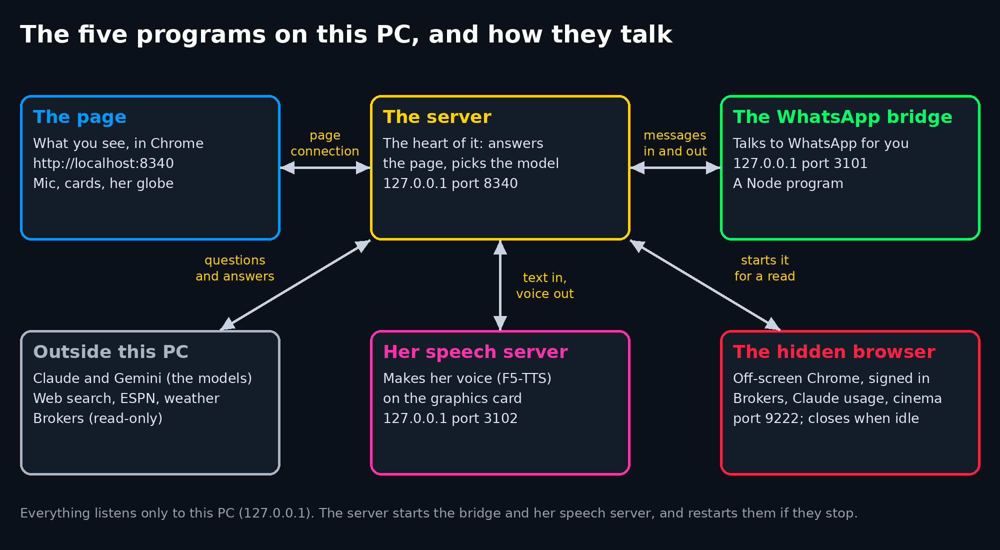

# Meet Khadijah

**A personal AI voice assistant with a holographic dashboard, built and run on one Windows PC.**
Designed and built by **Rafiq Mateen**, AI creator.

**[Watch a short demo, with her real voice](video/khadijah-demo.mp4)**

You talk to her, or type to her. She thinks with Claude, answers out loud in her own voice, which is cloned on the PC itself from a short recording, and runs a live dashboard around her: calendar and tasks, brokerage reports, local news and weather, sports, cinema listings, the machine's own health, the devices on the Wi-Fi, WhatsApp, and DaVinci Resolve video builds. Everything runs locally; nothing listens on the network.

---

## What she can do

| Area | Highlights |
|---|---|
| **Voice** | Hands-free conversation; replies spoken in a voice cloned on-device with F5-TTS (ElevenLabs as the switch-back); never hears herself; Escape stops her mid-sentence; say "open Calendar" or "go to Tasks" and the screen goes there; click a menu section and she says one short line about it (a Narrate switch turns that off) |
| **Brains** | Claude Haiku by default, Sonnet or Gemini by voice; hard questions move to Sonnet on their own, with an hourly cap; falls back gracefully when a model fails |
| **The dashboard** | A window of sections: a menu down the left, a stage in the middle, a panel on the right with her globe (name, state, model) and a dock along the bottom. Home shows glowing rings, one per group, with each group's node logos riding its ring; every node opens its own card on the stage; a Claude plan-limit card shows usage and spend, and its node wears an amber halo when the session or the week is at 90 percent |
| **Calendar and tasks** | Your Google Calendar month on screen: click a day to add an event, click an event to change or delete it, and it is saved straight to Google. Tasks are ticked, added, edited and deleted by mouse or by voice ("add task buy milk", "undo that") |
| **Money, read-only** | Interactive Brokers and Webull balances and positions as reports, graded from strong to critical. Nothing can ever place a trade, and an automated check enforces it |
| **Local life** | Weather in °F, currency outlook and local alerts; the Cartagena news card draws the dollar's recent trend as a line chart, oldest rate at the left, newest at the right, with the span of days beside it; films showing nearby with posters and English synopses; five pro teams' scores and standings |
| **WhatsApp** | Every chat on one screen with its own reply box; voice notes are written out as text on the PC, messages show in English and replies go out in the contact's language; a morning brief arrives on the phone at 7 AM |
| **The machine** | Live CPU, memory, GPU and disk readout; a disk auditor with a preview-first junk cleaner; a Wi-Fi map that flags unknown devices and links to the router to check them; a weekly security check for Node.js and Python packages, which she also runs when asked |
| **Creative tools** | Plans drone missions on a map, imports the footage with a confirm step and sorts it by mission; builds and renders a 4K DaVinci Resolve timeline from it |
| **Market research** | Tears down any website in a hidden Chrome tab: its tech stack, a rebuild recipe, and what the evidence can't show; a local LLM for day-to-day questions at no ongoing SaaS cost; a "Great Debate" where two AI voices argue a plan until they agree |
| **Web and screen** | Web search with a spoken summary (Tavily, falling back to DuckDuckGo); a tabbed Google News card (Home, For you, Following and a row of sections), each headline a link to its article; looks at the screen and describes it |

## A look around

Home is the first screen: the menu of sections down the left, the groups' nodes riding glowing rings across the middle, her globe in the panel on the right, the machine readout along the top and the typing box along the bottom. The rings light up in waves while she listens, thinks or talks.

**Standing by.** The menu on the left, the rings of nodes, her globe on the right and the machine readout at the top.

**Listening, with a card open.** The globe glows blue while she listens; here the Philly Sports card is open.

**The calendar.** A month of Google Calendar, today outlined, with arrows and a Today button. (The events shown are made up.)

**Adding an event.** Click a day and the form opens beside the month; Save puts it on Google Calendar.

**Tasks.** Open tasks and coming calendar items in one list, with an Add box at the bottom. (The tasks shown are made up.)

**Google News.** A tabbed card (Home, For you, Following and a row of sections); each headline is a link to its article.

**Every part of the screen, labelled in plain words.**

## How it is built

| Part | Built with |
|---|---|
| Server | Python 3.12, FastAPI, WebSocket; split into routes, services and model clients |
| Dashboard | Plain JavaScript with no build step, a glass-panel design system, three.js only for the turning sphere of her globe |
| Models | Anthropic API (Claude Haiku and Sonnet), Google Gemini, with routing, fallbacks and rate limits |
| Voice | F5-TTS running on the graphics card in its own Python environment; ElevenLabs as the alternative |
| WhatsApp | A Node.js bridge on Baileys, supervised and restarted by the server |
| Data | Broker interfaces (read-only), Google Calendar (through a service account that may only touch events), Google News feeds, ESPN, weather and currency feeds, cinema sites and any site Reverse Engineer tears down, read through a hidden Chrome |

**Engineering choices worth a look**

- **Local-only by design.** Every service binds to 127.0.0.1; the server checks Host and Origin on every request and on the WebSocket, and sends a strict Content Security Policy.
- **Read-only money, enforced by code.** Broker access is limited to account reads, and a checker scans the code for any order-placing call.
- **A tripwire on its own files.** A watchdog keeps a cryptographic fingerprint of the project's real working files — leaving out the ones that are generated, downloaded or copied by design — and re-checks them every twenty seconds, logging each change. If a file's content ever goes back to something it held earlier — the signature of a silent revert — it raises an alert on the desktop with a beep. It also reports anything that changed while it was not running.
- **Documentation tested against the code.** A script checks the guide against the real files, names and load order, so the docs cannot drift.
- **Built with AI, engineered like software.** Developed with Claude Code under written working rules: backups before every change, byte-verified writes, one commit per session.

## The code

The source code is private. If you would like to review it, contact me and I will give you access.

## Credits

Khadijah began from Julian Ivanov's open-source jarvis-voice-assistant template and was rebuilt from there into what you see here.

© 2026 Rafiq Mateen. All rights reserved.

<!-- 4a-fingerprint: 72c232d7bb76563c -->
